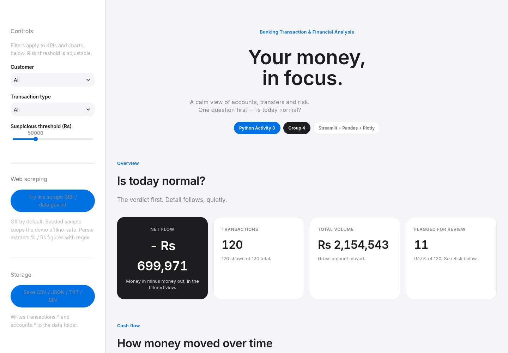
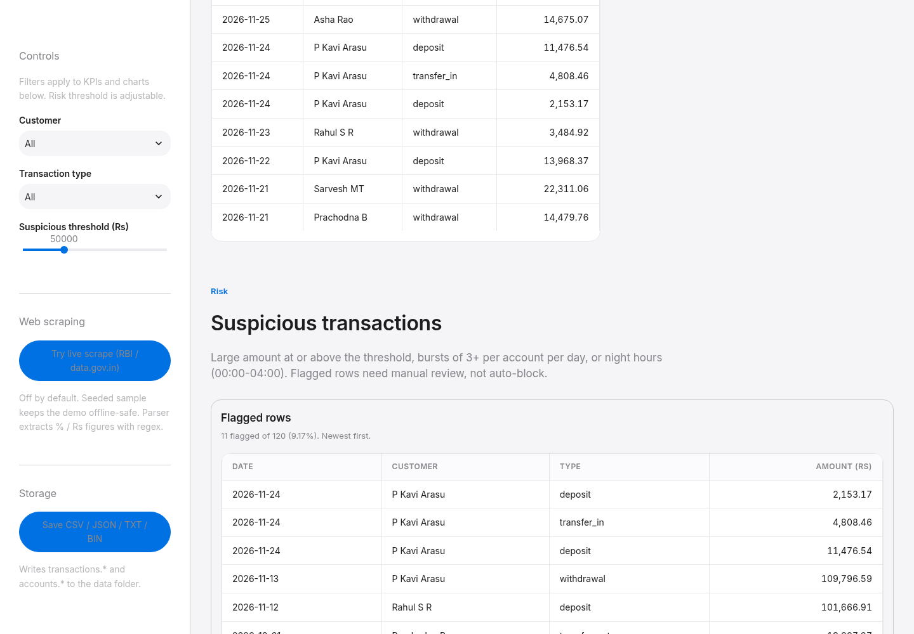
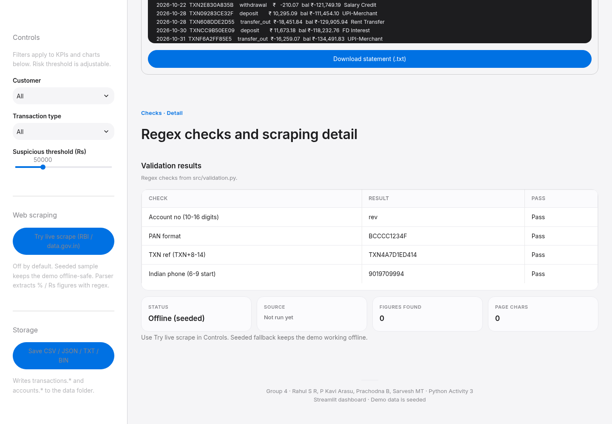

# Banking Transaction & Financial Analysis System

**Python Activity 3 · Group 4** · A premium fintech dashboard for accounts, transfers, fraud flags, daily / monthly / yearly analytics & statements.

> Apple-inspired premium design (Apple.com product-page language), built with Streamlit + Plotly. Big honest headlines, generous whitespace, verdict row first, restrained motion, no decorative gradients.







## Team (4 members)

| Name | USN |
|---|---|
| Rahul S R | JCJ26012995 |
| P Kavi Arasu | JCJ26012989 |
| Prachodna B | JCJ26012990 |
| Sarvesh MT | JCJ26013012 |

Source: `1st_Sem_PYTHON Programming _list_MCA_A`, Sheet1.

## Features

- **Accounts & balances** — 6 seeded customers with opening balances, branches and PAN-format placeholders.
- **Transfers with error handling** — live transfer demo checks account format (regex), amount > 0 and sufficient balance. Insufficient funds are rejected with the exact available / requested amounts. Undo via stack.
- **Suspicious-transaction detection** — large at/above threshold · burst 3+ per account per day · night hours 00:00–04:00. Transparent, auditable rules; flagged rows need manual review, not auto-block.
- **Analytics** — daily net flow (60 days), monthly in vs out, yearly count/net, spending by counterparty, transaction mix — all with NumPy + Pandas (groupby, rolling stats, quantiles).
- **Regex validation** — account numbers (10–16 digits), PAN, TXN refs, Indian phone, email, amount. Plus a demo text-extractor.
- **Web scraping** — optional live scraping of permitted pages (RBI / data.gov.in) with regex %/Rs parsing. Seeded fallback so the demo always runs offline.
- **Multi-format storage** — CSV, JSON, text and binary (pickle) for transactions and accounts, plus downloadable account statements.
- **Extra 1 — Monthly insights & savings goal** — income / spend / net, savings rate, top spend per month, and a monthly-compounding goal projection chart.
- **Extra 2 — One-click statement export** — per-customer text statement with running balance, downloadable from the dashboard.

## Design choices (research-backed)

- **Layout (Apple product-page):** one idea per scene — hero -> verdict row -> cash flow -> spending -> working tables -> risk -> actions. Huge tight headlines, generous whitespace, hairline borders, rounded bento cards. Topbar removed in favour of a centered hero ("Your money, in focus.").
- **Typography:** SF stack / Inter. 56px hero, 32px section titles, tabular figures for every number. Largest type carries the verdict (net flow).
- **Colour:** two grays + one blue (#0071e3). Blue is action, ink is neutral, red is risk. No decorative gradients — colour means state.
- **Motion (Apple-restrained):** CSS fade-up scroll reveals (IntersectionObserver), KPI count-up, hover lifts on cards, pill buttons with scale feedback. `prefers-reduced-motion` respected. No true scroll-parallax (not possible without JS scroll hacks in Streamlit).
- **Charts:** Plotly `simple_white` with custom Inter theme. Daily net flow is a 7-day rolling mean (weekly ticks) so the shape reads calmly; monthly in-vs-out grouped bars; sorted horizontal bars for spending/mix (no pie).
- **Tables:** custom Apple HTML tables (no truncated edges, fewer columns) and styled status cards for scrape detail instead of a raw JSON dump.
- **Chrome:** Streamlit default header/footer/menu hidden via CSS; theming lives in `.streamlit/config.toml` + CSS variables. No emojis (avoid glyph tofu) — text pills carry status.

## Requirement mapping (Activity 3, Group 4)

| Requirement | Where |
|---|---|
| Data structures (dict, list, deque, queue, stack, defaultdict, set via counterparties) | `src/data_structures.py` — used live in `app.py` |
| NumPy + Pandas | `src/analysis.py` (groupby, rolling stats, quantiles) |
| Regex | `src/validation.py` (account/PAN/TXN/phone/email) + `src/scraper.py` (Rs/% extraction) |
| Web scraping (permitted sites) | `src/scraper.py` → RBI / data.gov.in with fallback |
| CSV / JSON / text / binary storage | `src/storage.py` — `data/` files |
| Reporting | Statements (`export_statement`), fraud table, insights, in-app charts |
| Extra features | `src/insights.py` (monthly insights + goal) · statement export in `app.py` |

## Project structure

```
.
|-- app.py                 # Streamlit dashboard (premium fintech UI)
|-- screenshot.py          # Playwright screenshot helper (waits for chart render)
|-- requirements.txt
|-- .streamlit/config.toml # Streamlit theme
|-- screenshots/           # Dashboard screenshots
|-- data/                  # Saved CSV / JSON / TXT / BIN exports
`-- src/
    |-- data_structures.py # dict / list / deque / queue / stack / defaultdict / set
    |-- analysis.py        # NumPy + Pandas analytics
    |-- validation.py      # Regex checks + TXN ref generator
    |-- fraud.py           # Suspicious-transaction rules
    |-- scraper.py         # Permitted-site scraping + seeded sample
    |-- storage.py         # CSV / JSON / TXT / BIN + statements
    `-- insights.py        # Extra: monthly insights + goal projection
```

## Run

```bash
pip install -r requirements.txt
streamlit run app.py
```

Open the printed local URL. No API keys needed.

## Data

`data/` holds saved exports (`transactions.*`, `accounts.*`). Demo customers & transactions are seeded, realistic values for the assignment demo — swap with real statements where needed.

## GitHub

This repo is the submission link for Python mam. Code + README are the deliverable; Classroom submission is done separately by the team.
